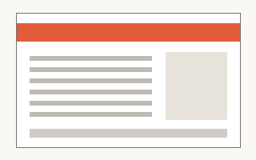

# PDF Processing

Work with PDF documents: extract content, fill forms, and merge files.

## When to use

- The user shares a `.pdf` file or asks for one to be produced.
- A task involves forms, tables, or scanned documents.

## Quick start

Extract the text of every page:

```python
import pdfplumber

with pdfplumber.open("report.pdf") as pdf:
    for page in pdf.pages:
        print(page.extract_text())
```

## Workflows

| Task            | Tool                         | Notes                          |
| --------------- | ---------------------------- | ------------------------------ |
| Extract text    | `scripts/extract_text.py`    | Falls back to OCR when empty   |
| Fill a form     | `scripts/fill_form.py`       | Read the form guide first      |
| Merge documents | `pypdf.PdfWriter`            | Keep bookmarks with `outline`  |

### Extracting text

Run the extraction script and pass the input path:

```bash
python scripts/extract_text.py input.pdf --format markdown
```

### Filling forms

Form fields are easy to get wrong. Follow [the form guide](references/FORMS.md)
before writing any values, and check the
[layout reference](references/layout.md) when positions matter.

1. List the fields with `scripts/fill_form.py --list form.pdf`.
2. Map user data to field names.
3. Write values and **verify** the output visually.

## Page anatomy



## Edge cases

- [x] Encrypted files: ask for the password, never guess.
- [x] Scanned pages: no text layer, use OCR.
- [ ] Right-to-left scripts: extraction order may be reversed.

> Never overwrite the user's original file. Write results to a new path.
